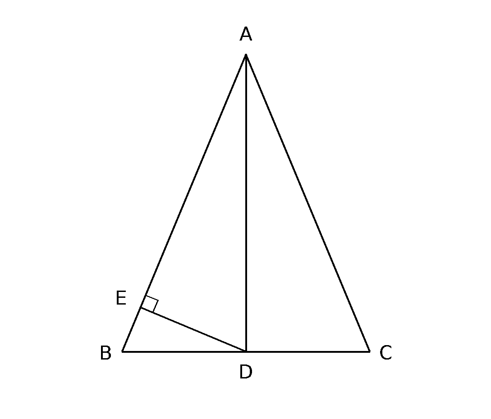
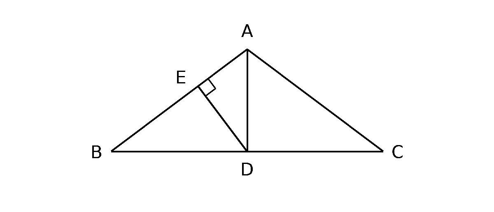
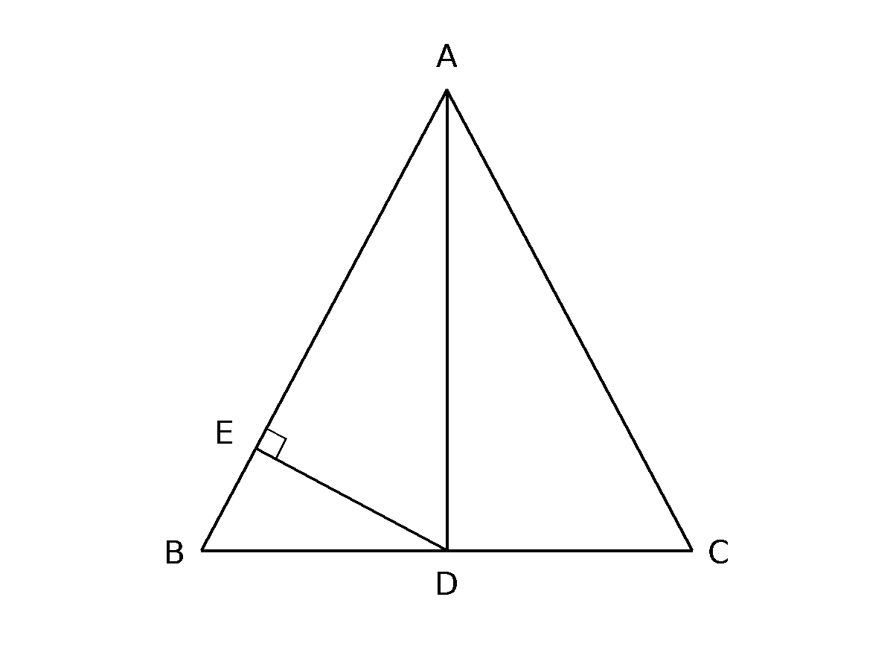

第18题 同类练习

同类题 1

如图，在$\triangle ABC$中，$AB=AC=13$，$BC=10$，$D$为$BC$的中点，$DE\perp AB$，垂足为$E$。

（1）求证：$AD\perp BC$；

（2）求$AD$的长；

（3）求$DE$的长。

同类题 2

如图，等腰$\triangle ABC$的周长为$36$，底边$BC=16$，$AB=AC$，点$D$是$BC$的中点，过$D$作$DE\perp AB$于$E$。

（1）求证：$\angle BAD=\angle CAD$；

（2）求腰长$AB$及$AD$的长；

（3）求$DE$的长。

同类题 3

如图，在$\triangle ABC$中，$AB=AC=17$，$D$是$BC$的中点，$AD=15$，$DE\perp AB$于点$E$。

（1）求证：$\angle BAD=\angle CAD$；

（2）求$BC$的长；

（3）求$DE$的长。
