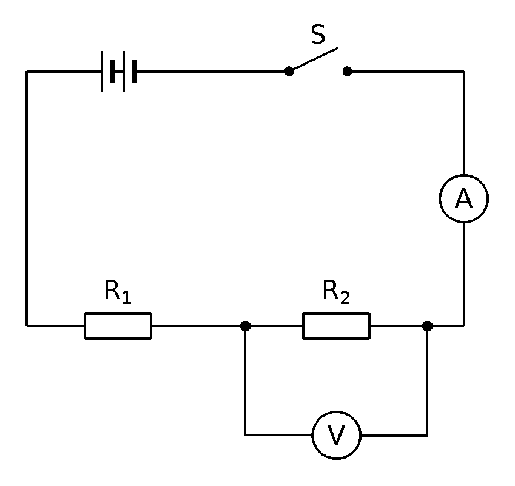

第21题 同类练习

同类题 1

如图所示电路，电源电压不变，$R_1=20\,\Omega$。闭合开关$S$后，电流表示数为$0.2\,\mathrm{A}$，电压表示数为$2\,\mathrm{V}$。

（1）求电源电压$U$；

（2）求电阻$R_2$的阻值；

（3）若用阻值为$40\,\Omega$的电阻$R_3$替换$R_2$，求电流表的示数。

同类题 2

在图示电路中，电源电压保持不变。已知$R_1=5\,\Omega$，闭合开关$S$，电压表测得$R_2$两端电压为$4\,\mathrm{V}$，电流表读数为$0.4\,\mathrm{A}$。

（1）求电源电压$U$；

（2）求电阻$R_2$的阻值；

（3）若用阻值为$25\,\Omega$的电阻$R_3$替换$R_2$，求电流表的示数。

同类题 3

小明用如图所示的电路做实验，电源电压恒定，定值电阻$R_1$的阻值为$12\,\Omega$。他闭合开关$S$后记下：电流表读数$0.25\,\mathrm{A}$，电压表读数$6\,\mathrm{V}$。

（1）求电源电压$U$；

（2）求电阻$R_2$的阻值；

（3）小明随后断开开关，把一个$6\,\Omega$的电阻$R_3$接在原来$R_2$的位置，再闭合开关，电流表读数变为多少？
